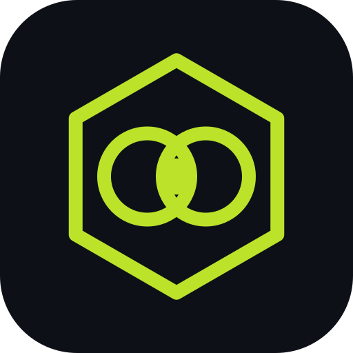

<h1 align="center">Pro mTLS Manager</h1>

<p align="center">
  
</p>

<p align="center"><b>Only your own devices get in.</b></p>

<p align="center"><a href="#1-install-pro-mtls-manager">Install</a> · <a href="#features">Features</a> · <a href="#how-it-works">How it works</a> · <a href="#3-set-up-caddy">Caddy setup</a></p>

Pro mTLS Manager is your own little certificate authority. Make a certificate for each phone or laptop, install it from a .p12 file, and Caddy lets in only those devices. Lost a phone? Revoke it with one click.


[](https://github.com/CJNG20u/Pro-mTLS/pkgs/container/pro-mtls)

🐳 **Docker image:** `ghcr.io/cjng20u/pro-mtls:latest` (amd64 + arm64)

```bash
docker pull ghcr.io/cjng20u/pro-mtls:latest
```

Self-hosted private CA & mTLS client-certificate manager for Caddy, now with secure login and an installable iOS/Android PWA. Issue .p12 certs, revoke via CRL, sync to Caddy over SSH. Docker-ready.

> 🙌 **Revocation powered by [caddy-revocation-validator](https://github.com/Gr33nbl00d/caddy-revocation-validator) by [@Gr33nbl00d](https://github.com/Gr33nbl00d).** Caddy can't check CRLs on its own, and this plugin is what makes one-click revocation work. Huge thanks for a great, well-built project. Go give it a ⭐!

## Features

- **Private root CA**: create an RSA 2048/4096 root CA with your own name, organization and validity.
- **Client certificates**: issue per-device certs and download them as `.p12` (password-protected or passwordless), `.crt` or `.key`.
- **Per-hostname access**: limit each cert to specific hostnames (for example `photos.example.com` or `*.example.com`). Caddy enforces this with a matcher.
- **Revocation and CRL**: revoke a cert with a reason, and the CRL (`crl.pem`) is regenerated straight away.
- **Caddy sync over SSH**: upload `ca.crt` and `crl.pem` to your Caddy server and reload it, by hand or automatically on every revoke. Password or key auth, with encrypted key passphrase support.
- **Expiry tracking**: see active, expiring-soon, expired and revoked certs at a glance.
- **Device setup guides**: install steps for Android, iOS, Windows, macOS and Linux.
- **Installable phone app (PWA)**: add it to your iPhone or Android home screen and open it full-screen like a native app.
- **Built-in login**: the dashboard and every download need a sign-in. Strong password hashing, revocable sessions, and rate-limited login attempts.

## How it works

```
 ┌──────────────────────┐   SSH: ca.crt + crl.pem   ┌───────────────────────────┐
 │  Pro mTLS Manager    │ ────────────────────────▶ │  Caddy (VPS / reverse     │
 │  (Docker, homelab)   │      + caddy reload       │  proxy) with revocation   │
 │  root CA · certs·CRL │                           │  plugin                   │
 └──────────────────────┘                           └─────────────┬─────────────┘
            │ .p12                                                │ mTLS
            ▼                                                     ▼
     your phone / laptop ───────── presents client cert ───▶  your services
```

---

## 1. Install Pro mTLS Manager

### Docker (recommended)

Requirements: Docker with the Compose plugin. Any Linux host works, including a Proxmox LXC with Docker installed.

```bash
git clone https://github.com/CJNG20u/Pro-mTLS.git
cd Pro-mTLS
docker compose up -d --build
```

Open `http://<server-ip>:3000`.

#### Prefer not to build? Use the prebuilt image

A ready-made image is published to GitHub Container Registry on every push to `main`. Save this as `docker-compose.yml` in an empty folder:

```yaml
services:
  pro-mtls-manager:
    image: ghcr.io/cjng20u/pro-mtls:latest
    container_name: pro-mtls-manager
    restart: unless-stopped
    ports:
      - "3000:3000"
    env_file:
      - path: .env
        required: false
    environment:
      - DATA_DIR=/app/pki_storage
    volumes:
      - ./pki_storage:/app/pki_storage
```

```bash
docker compose pull && docker compose up -d
```

Images are built automatically for `linux/amd64` and `linux/arm64`. `:latest` follows `main`; each release also gets version tags (e.g. `:2.0.0`, `:2`) so you can pin a version. The repo's own `docker-compose.yml` also pulls this image first and only builds from source when you pass `--build`.

To update later:

```bash
cd Pro-mTLS
git pull
docker compose up -d --build
```

### Without Docker (bare metal / LXC + systemd)

Requirements: Debian/Ubuntu, Node.js 20+ (22 LTS recommended) and the `openssl` command-line tool.

```bash
sudo git clone https://github.com/CJNG20u/Pro-mTLS.git /opt/pro-mtls-manager
cd /opt/pro-mtls-manager
sudo cp .env.example .env && sudo chmod 600 .env   # optional, edit as needed
sudo ./install.sh                                   # checks prereqs, installs deps, builds the UI
```

`install.sh` is safe to run again after `git pull`. It finishes by printing the steps to enable the systemd service:

```bash
sudo cp pro-mtls-manager.service /etc/systemd/system/
sudo systemctl daemon-reload
sudo systemctl enable --now pro-mtls-manager
journalctl -u pro-mtls-manager -f
```

The unit expects the app in `/opt/pro-mtls-manager`. If you installed it somewhere else, edit the paths in the `.service` file.

Prefer to run it by hand? `npm install && npm run build && npm start`.

### Configuration (optional)

Everything works out of the box. To change defaults, copy `.env.example` to `.env` and uncomment what you need. Docker Compose picks up `.env` automatically.

| Variable | Default | What it does |
|----------|---------|--------------|
| `PORT` / `HOST` | `3000` / `0.0.0.0` | Where the web UI listens (bare metal only; in Docker change the `ports:` mapping) |
| `DATA_DIR` | `./pki_storage` | Where the CA, certs, CRL and settings are stored (fixed to `/app/pki_storage` in Docker) |
| `CA_AUTO_INIT` | `false` | Create the root CA automatically on first start |
| `CA_COMMON_NAME`, `CA_ORGANIZATION`, `CA_ORGANIZATIONAL_UNIT`, `CA_COUNTRY`, `CA_VALIDITY_DAYS`, `CA_KEY_SIZE` | see `.env.example` | Root CA details for auto-init; also pre-filled in the Initialize CA form |
| `DEFAULT_ALLOWED_HOSTS` | *(empty)* | Comma-separated hostnames pre-filled when issuing certs, e.g. `*.example.com` |
| `CRL_VALIDITY_DAYS` | `30` | How long each generated CRL is valid |
| `CRL_OUTPUT_PATH`, `CA_CERT_OUTPUT_PATH` | *(off)* | Also write `crl.pem` / `ca.crt` to these paths, for Caddy on the **same machine** |
| `CADDY_AUTO_RELOAD_LOCAL` | `false` | Run `CADDY_RELOAD_CMD` locally after every revoke/delete (needs `CRL_OUTPUT_PATH`) |
| `CADDY_REMOTE_CERTS_DIR` | `/etc/caddy/certs` | Default certs folder in the Server Sync panel |
| `CADDY_RELOAD_CMD` | `sudo systemctl reload caddy` | Command used to reload Caddy (remote SSH default and local reload) |
| `SSH_KEY_PATH` | *(none)* | SSH key used when none is entered in the UI. Otherwise `~/.ssh/id_ed25519`, then `~/.ssh/id_rsa` |
| `ADMIN_USER` / `ADMIN_PASSWORD` | *(none)* | Create the admin account on first start instead of using the first-run screen. Ignored once an account exists |
| `TRUST_PROXY` | *(off)* | Set to `1` when the app sits behind one reverse proxy (Caddy, nginx, Cloudflare Tunnel) so login rate limiting sees each visitor's real IP |
| `ALLOWED_ORIGINS` | *(none)* | Only if your proxy rewrites the `Host` header and sign-in is blocked as cross-origin. Comma-separated hostnames |
| `AUTH_DISABLED` | `false` | `true` turns the login **off**. Only use it behind another access layer such as mTLS or a VPN |
| `AUTH_SALT` | `mtls_salt` | Only used to read an old dashboard password from an earlier version so it can be upgraded. New installs don't need it |
| `STRICT_ENV_VALIDATION` | `false` | Refuse to start unless the core variables are set explicitly |

#### Caddy on the same machine

If Caddy runs on the same host as Pro mTLS Manager (bare metal), you don't need SSH at all. Set `CRL_OUTPUT_PATH=/etc/caddy/certs/crl.pem` and `CA_CERT_OUTPUT_PATH=/etc/caddy/certs/ca.crt`. The Server Sync page then shows a **Publish & Reload Local Caddy** button, and with `CADDY_AUTO_RELOAD_LOCAL=true` Caddy is reloaded automatically after every revocation.

### Login & security

This app holds your CA private key, so it is always behind a sign-in. Sessions last 30 days per device. Under **Settings → Dashboard Security** you can change your password or sign out of every device.

- **Upgrading from an older version?** If you had a dashboard password, just sign in with it once. It is upgraded to a stronger hash and becomes the account `admin`. If you never set a password, you will be asked to create an account on first visit.
- **Scripts and curl:** the old copyable API token is gone, and tokens are no longer accepted in URLs. Sign in with a cookie jar instead:
  ```bash
  curl -c jar.txt -H 'Content-Type: application/json' -d '{"username":"admin","password":"..."}' https://ca.example.com/api/auth/login
  curl -b jar.txt https://ca.example.com/api/certs
  ```
- **Behind a reverse proxy:** set `TRUST_PROXY=1`. If sign-in says "Cross-origin request blocked", add your hostname to `ALLOWED_ORIGINS`.
- **Forgot your password?** Stop the app, delete `pki_storage/auth.json`, and start it again. You'll be asked to create a new account. Your CA and certificates are not touched.
- Login protects access but doesn't encrypt traffic. Serve the dashboard over HTTPS if it is reachable beyond your home network.

### Use it on your phone (PWA)

Pro mTLS Manager installs as an app on iPhone, iPad, Android and desktop, so you can issue or revoke a certificate from your phone in seconds. Installing needs the page to be served over **HTTPS** (or `localhost`), so open it through your normal HTTPS address, not `http://<ip>:3000`.

- **iPhone / iPad:** open the page in **Safari**, tap **Share → Add to Home Screen**, leave **Open as Web App** on, and tap **Add**.
- **Android:** open it in Chrome, then tap the menu **⋮ → Install app** (or **Add to Home screen**). The page also shows an **Install** button under **Settings → Install as an app**.

The app only caches its own screens. Certificates, keys, the CA and the CRL are never stored on the phone by the app, and you still sign in as usual. If you installed an older version, remove the icon and add it again to refresh the icon and colors.

### Your data: back it up

Everything the app creates (the CA **private key**, issued certificates, the CRL and settings) is stored in `./pki_storage` (or `DATA_DIR`). In Docker it's mounted into the container at `/app/pki_storage`.

> ⚠️ Anyone with `pki_storage/ca` can issue certificates your Caddy server will trust. Keep it private, back it up off the host, and **never commit it to Git**. `.gitignore` already excludes it.

**Moving an existing install:** stop the app and copy the old `pki_storage` folder into the new `Pro-mTLS/` folder. Your CA and all your certificates carry over unchanged.

---

## 2. First run

1. **Initialize Root CA**: choose a name, organization, key size (4096 recommended) and validity.
2. **Create your admin account**: the first time you open the page it asks for a username and password (at least 10 characters). **Do this right after starting the container**, because until the account exists, whoever reaches the page first can create it. You can also set `ADMIN_USER` and `ADMIN_PASSWORD` in `.env` to create it automatically. See [Login & security](#login--security).
3. **Server Sync**: enter your Caddy server's host, SSH user, and either a password or a private key. Click **Test SSH Connection**, then **Save Configuration**.
4. **Issue Certificate** for each device, then download the `.p12` and install it on the device (see **Device Setup Guides** in the app footer).

---

## 3. Set up Caddy

Stock Caddy can verify client certificates against your CA, but it **cannot check a CRL**, so revoked certificates would still be accepted. To make revocation work, build Caddy with the **[caddy-revocation-validator](https://github.com/Gr33nbl00d/caddy-revocation-validator)** plugin using `xcaddy`.

The plugin needs Caddy 2.8.4 or newer.

### 3.1 Build Caddy with the revocation plugin

On the Caddy server (Debian/Ubuntu shown; Go 1.22+ is required):

```bash
# Install Go if you don't have it
sudo apt update && sudo apt install -y golang-go
go version            # needs 1.22+; if older, install Go from https://go.dev/dl/

# Install xcaddy
go install github.com/caddyserver/xcaddy/cmd/xcaddy@latest
export PATH=$PATH:$(go env GOPATH)/bin

# Build Caddy with the plugin (the module path is lowercase)
xcaddy build --with github.com/gr33nbl00d/caddy-revocation-validator
```

This creates a `./caddy` binary in the current folder.

### 3.2 Replace the packaged Caddy binary

If Caddy was installed from the official apt repo, use the method recommended in the Caddy docs so package updates don't overwrite your build:

```bash
sudo dpkg-divert --divert /usr/bin/caddy.default --rename /usr/bin/caddy
sudo mv ./caddy /usr/bin/caddy.custom
sudo update-alternatives --install /usr/bin/caddy caddy /usr/bin/caddy.default 10
sudo update-alternatives --install /usr/bin/caddy caddy /usr/bin/caddy.custom 50
sudo systemctl restart caddy
```

Check that the plugin is loaded:

```bash
caddy list-modules | grep revocation
# tls.client_auth.verifier.revocation
```

> 💡 No Go on the server? Build on any Linux machine with the same CPU architecture and copy the binary over. If the plugin is listed on <https://caddyserver.com/download>, you can also download a ready-made build there.

### 3.3 Prepare the certs folder

```bash
sudo mkdir -p /etc/caddy/certs /var/lib/caddy/crl-work
sudo chown -R caddy:caddy /var/lib/caddy/crl-work
```

The SSH user you configured in Pro mTLS Manager must be able to write to `/etc/caddy/certs` and run the reload command (default `sudo systemctl reload caddy`). The `caddy` user must be able to **read** `ca.crt` and `crl.pem`.

Then click **Sync to Caddy Now** in the app. `ca.crt` and `crl.pem` should appear in `/etc/caddy/certs`.

### 3.4 Caddyfile

Add a `client_auth` block to each site you want to protect. The **Server Sync** page in the app generates this block with your paths filled in; use **Copy Caddyfile**.

```caddyfile
app.example.com {
    tls {
        client_auth {
            mode require_and_verify
            trusted_ca_cert_file /etc/caddy/certs/ca.crt

            # CRL checking (caddy-revocation-validator plugin)
            verifier revocation {
                mode crl_only
                crl_config {
                    work_dir /var/lib/caddy/crl-work
                    storage_type memory
                    signature_validation_mode verify
                    trusted_signature_cert_file /etc/caddy/certs/ca.crt
                    crl_file /etc/caddy/certs/crl.pem
                }
            }
        }
    }

    # Optional: only allow certs issued for this hostname (or a matching wildcard)
    @forbidden not expression `{http.request.tls.client.subject}.contains("OU=host:*.example.com") || {http.request.tls.client.subject}.contains("OU=host:" + {http.request.host})`
    respond @forbidden "403 Forbidden: Certificate not authorized for this hostname" 403

    reverse_proxy localhost:8080
}
```

Then reload Caddy:

```bash
caddy validate --config /etc/caddy/Caddyfile
sudo systemctl reload caddy
```

The plugin loads `crl_file` when Caddy starts or reloads. Pro mTLS Manager reloads Caddy after every sync, so revocations take effect right away.

> ⚠️ **Behind Cloudflare?** If a hostname is proxied through Cloudflare (orange cloud or a Cloudflare Tunnel), Cloudflare ends the TLS connection and Caddy never sees the client certificate. Caddy's mTLS only works when clients connect to Caddy directly: a DNS-only (grey cloud) record, or LAN/VPN access. For proxied hostnames, use Cloudflare's own mTLS feature instead.

---

## 4. Test it

```bash
# Without a certificate: should be rejected
curl -v https://app.example.com

# With a certificate: should work
openssl pkcs12 -in device.p12 -out device.pem -nodes   # enter the .p12 password if set
curl -v --cert device.pem https://app.example.com
```

Then revoke that certificate in the app, wait for the auto-sync to finish, and run the second command again. It should now be rejected. On phones, fully close the browser before retesting, because it may reuse the existing connection.

---

## Troubleshooting

| Problem | Fix |
|---------|-----|
| `spawn openssl ENOENT` | The `openssl` CLI is missing. It's included in the Docker image; for bare installs, run `apt install openssl`. |
| Revoked cert still works | Caddy isn't checking the CRL. Confirm `caddy list-modules \| grep revocation` shows the module, that the `verifier revocation` block is in your Caddyfile, and that Caddy was reloaded after the sync. |
| Valid cert is rejected | Check that the hostname isn't proxied through Cloudflare, that the cert's allowed hosts include the hostname, and that the cert isn't expired. |
| Sync fails on reload | The SSH user needs permission to run the reload command, for example passwordless `sudo` for `systemctl reload caddy`. |
| SSH key fallback | If no key is entered in the app, it reads `/root/.ssh/id_rsa` inside the container. Uncomment the key mount in `docker-compose.yml` to use the host's key. |

## Development

```bash
npm install
npm run dev     # Express API + Vite dev server with hot reload on :3000
```

Stack: React 19, Vite, Tailwind CSS 4, Express, node-forge, ssh2.

## Credits

- **[caddy-revocation-validator](https://github.com/Gr33nbl00d/caddy-revocation-validator)** by [@Gr33nbl00d](https://github.com/Gr33nbl00d): the Caddy plugin that adds CRL and OCSP revocation checking to `client_auth`. Without it, revoked certificates would still be accepted. Thank you for the excellent work!
- [Caddy](https://caddyserver.com) and [xcaddy](https://github.com/caddyserver/xcaddy)
- [node-forge](https://github.com/digitalbazaar/forge) and [ssh2](https://github.com/mscdex/ssh2)

## License

[MIT](LICENSE)
